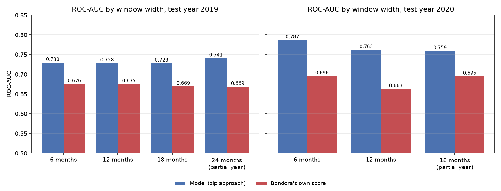
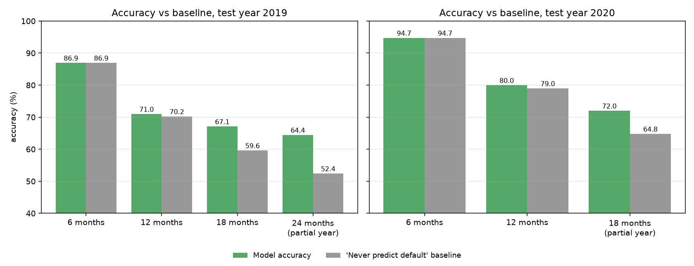

# Predicting 12-Month Default on Bondora P2P Loans

Machine Learning Innovative Assignment: written report

## 1. Summary

We predict, at the moment a loan is issued, whether it will default within 12 months, using only information available at issuance. The model is a gradient-boosted tree selected on a validation year, refitted on all earlier data, and scored once on a held-out later year. Its ranking quality is compared with the platform's own risk score (`ProbabilityOfDefault`) on exactly the same loans.

**Headline (test year 2020, 12-month window, 18,651 loans):**

| Measure | Our model (CatBoost) | Bondora's own score | Reference |
|---|---|---|---|
| ROC-AUC | **0.762** | 0.663 | 0.500 = chance |
| PR-AUC (lift) | **0.455 (2.2x)** | 0.341 | 0.210 = default rate |
| Accuracy | **80.0%** | not applicable | 79.0% = "never predict default" |
| Recall of defaults (at the validation threshold) | 0.14 | | |

**How to read this honestly.** The model ranks borrowers clearly better than Bondora's score, in every country and every window width tested. The accuracy figure is high mainly because only 21% of 2020 loans defaulted; the edge over simply predicting "no default" is about one percentage point. For that reason ROC-AUC, PR-AUC and lift are the primary measures, and accuracy is always reported next to its baseline.

**Robustness.** The same protocol was repeated for four window widths (6, 12, 18, 24 months) and for 2019 as an earlier, pre-COVID test year. The model beats Bondora's score in all 7 feasible runs, by 0.05 to 0.10 ROC-AUC.

## 2. Problem definition and use case (Stage 1)

* **Problem.** Investors on peer-to-peer platforms bear the credit risk of loans they fund. Bondora publishes its own score, but it is not known how much default risk is predictable from application data, or whether an independent model ranks borrowers better.
* **Stakeholders.** Retail investors (which loans to fund), the platform (scoring and pricing), borrowers (access to credit).
* **Target.** `default_within_12m` = 1 if the loan's `DefaultDate` falls in `[LoanDate, LoanDate + 12 months)`.
* **Inputs and outputs.** Application and loan-term data, credit scores and pre-loan history in; a default probability and a fund / skip decision out.
* **Constraints.** Nothing from after issuance may be used; evaluation must be chronological.
* **Expected impact.** Fewer defaults among funded loans, measured as the default rate of the loans a threshold would fund versus funding everything.

## 3. Data (Stage 2)

* **Source.** The public Bondora loan dataset (Kaggle copy `bondora-peer-to-peer-lending-loan-data`, file `LoanData_Bondora.csv`). Bondora is the data owner. The team should check Bondora's usage terms before redistributing the raw file, which is why it is not bundled.
* **Size.** 179,235 loans, 112 columns, one row per loan, no duplicate rows. Snapshot date 2021-07-20.
* **Countries.** Estonia, Spain, Finland (plus a negligible number from Slovakia).
* **Limitations.** A single snapshot, so recent loans have had little time to default; Bondora's own scores are model outputs of unknown provenance; several borrower fields stopped being collected in June 2017.

## 4. The 12 pipeline stages: what was done and where to find it

| # | Stage | What was done and why | Evidence |
|---|---|---|---|
| 1 | Problem and use case | As in section 2. | Notebook section 1 |
| 2 | Data understanding | Size, types, missingness, identifiers, snapshot date. | Notebook section 2 |
| 3 | Data preparation | Dates parsed, text numerics coerced, no duplicates, impossible ages counted (53 loans, left as is). | Notebook section 3 |
| 4 | Preprocessing | Median imputation for numerics and a "missing" category for text fields, fitted on training years only. Trees need no scaling. | Notebook section 8 |
| 5 | Data balancing | About 30% defaults in training. Class weighting was compared: it moves the operating point and inflates probabilities but does not improve ranking. Validation and test are never resampled. | Notebook section 9 |
| 6 | EDA | Default rate by year and country, discovery that several borrower fields stop in June 2017, distributions, correlations. Training and validation years only. | Notebook section 7 |
| 7 | Feature engineering and selection | A leakage audit (every post-issuance, identifier, date and Bondora-score column excluded) and five issuance-time ratios (debt-to-income, funded/applied amount, monthly income, loan-to-income, negative-free-cash flag). | Notebook sections 5 and 8 |
| 8 | Baselines | Majority class, logistic regression, and Bondora's own score. | Notebook section 10 |
| 9 | Modelling | LightGBM, XGBoost, CatBoost: suited to mixed tabular data with missing values and interactions. | Notebook section 11 |
| 10 | Tuning | A grid over depth and regularisation on the validation year. | Notebook section 12 |
| 11 | Validation and evaluation | Chronological train / validation / test; model chosen by validation ROC-AUC; threshold chosen on validation; test scored once; confusion matrix, ROC and PR curves, calibration, per-country results. | Notebook sections 13 and 14 |
| 12 | Impact and limitations | Funding simulation, limitations, future work. | Notebook sections 14 and 16 |

## 5. Method in brief

* **Split (by origination year, never random).** Train 2013 to 2018 (71,563 loans), validation 2019 (55,839), test 2020 (18,651). The chosen model is refitted on train plus validation before the test.
* **Eligibility.** A loan is used only if its whole 12-month window ended before the snapshot. Loans issued later are dropped, never labelled as non-defaults. This applies the same rule to every split (the earlier submission also kept unfinished-window loans that had already defaulted, which inflates the latest cohort's default rate).
* **Leakage control.** Payments, balances, recoveries, status, delinquency, schedule fields, identifiers, raw dates and Bondora's own risk outputs are excluded. Bondora's score is used only as an external benchmark.
* **Model selection.** Highest validation ROC-AUC among logistic regression, LightGBM, XGBoost and CatBoost. The accuracy-optimal threshold is taken from validation. The chosen model is refitted on train plus validation with exactly the validated hyper-parameters and the test year is scored once.
* **Reproducibility.** Seed 42 everywhere; versions pinned in `requirements.txt`.

## 6. Results

### 6.1 Headline: test year 2020, window 12 months

Selected model: CatBoost (validation 2019 ROC-AUC 0.730; LightGBM 0.728, XGBoost 0.728, logistic regression 0.721).

| Metric | Value |
|---|---|
| Test loans / default rate | 18,651 / 21.0% (loans issued 1 January to 20 July 2020, the only ones with a full window) |
| ROC-AUC | 0.762 (Bondora 0.663) |
| PR-AUC | 0.455 (Bondora 0.341), lift 2.16 |
| Accuracy at the validation threshold | 79.95% (baseline 78.96%) |
| Precision / recall / F1 at that threshold | 0.60 / 0.14 / 0.23 |
| Accuracy / recall at threshold 0.5 | 80.1% / 0.28 |

By country, ROC-AUC (Bondora in brackets): Estonia 0.711 (0.616), Spain 0.619 (0.579), Finland 0.660 (0.557).

### 6.2 Window widths and test years

Metrics are not comparable across rows, because the window changes the base rate and the test loans. Each row must be read against its own references.

| Test year | Window | Test loans | Default rate | Model | ROC-AUC (Bondora) | PR-AUC | Accuracy vs baseline | Recall |
|---|---|---|---|---|---|---|---|---|
| 2020 | 6 months | 27,519 | 5.3% | CatBoost | 0.787 (0.696) | 0.206 | 94.7% vs 94.7% | 0.00 |
| 2020 | 12 months | 18,651 | 21.0% | CatBoost | 0.762 (0.663) | 0.455 | 80.0% vs 79.0% | 0.14 |
| 2020 | 18 months | 3,358 (Jan 1 to 20, 2020 only) | 35.2% | CatBoost | 0.759 (0.695) | 0.609 | 72.0% vs 64.8% | 0.49 |
| 2020 | 24 months | not possible: no 2020 loan has a full 24-month window | | | | | | |
| 2019 | 6 months | 55,839 | 13.1% | XGBoost | 0.730 (0.676) | 0.257 | 86.9% vs 86.9% | 0.00 |
| 2019 | 12 months | 55,839 | 29.8% | LightGBM | 0.728 (0.675) | 0.488 | 71.0% vs 70.2% | 0.15 |
| 2019 | 18 months | 55,839 | 40.4% | LightGBM | 0.728 (0.670) | 0.600 | 67.1% vs 59.6% | 0.47 |
| 2019 | 24 months | 23,734 (to 20 July 2019 only) | 47.6% | LightGBM | 0.741 (0.669) | 0.688 | 64.4% vs 52.4% | 0.42 |

What the sweep shows:

1. **Ranking barely depends on the window.** In 2019 the ROC-AUC is 0.728 to 0.730 for windows of 6, 12 and 18 months. The conclusions do not hinge on the choice of 12 months.
2. **The model beats Bondora's score in every feasible run**, by 0.05 to 0.07 in 2019 and by 0.07 to 0.10 in 2020. In Spain, Bondora's score ranks worse than chance in the 2019 24-month run (ROC-AUC 0.458; a partial-year test set).
3. **Accuracy depends on the base rate, not on skill.** At 6 months the models never flag a default, so their accuracy equals the 87% (2019) or 94.7% (2020) baseline. The accuracy edge reaches +7 to +12 points only where the classes are close to balanced (18 and 24 months).
4. **Two test sets are partial years** (2019 at 24 months, 2020 at 18 months). The 2020 18-month test set is only 20 days of loans and is noisy.

### 6.3 Funding use case

Ranking loans by predicted risk and declining the riskiest slice lowers the default rate of what is funded. Measured on the 2019 test year (12-month window, LightGBM, 55,839 loans, `results/test2019_n12_full_run/`):

| Riskiest share declined | Default rate of funded loans | Share of all defaults avoided |
|---|---|---|
| 0% (fund everything) | 29.8% | 0% |
| 10% | 27.1% | 18% |
| 20% | 24.0% | 35% |
| 30% | 21.1% | 50% |
| 50% | 15.2% | 74% |

The default rate rises steadily from 4.9% in the model's safest decile to 53.9% in the riskiest. Part of this spread is the country mix (Estonian loans are the safest and Spanish loans the riskiest), so it is not purely within-market ranking; per-country ROC-AUC (6.1) is the cleaner test of that. The notebook (section 14) produces the same table for the 2020 headline model, next to what Bondora's own score would have achieved.

### 6.4 Independent cross-check

A separate pipeline (second package, `Bondora_Supporting_Analysis`) built features, models and calibration independently. On the 2019 validation year it reached ROC-AUC 0.727 (LightGBM) and 0.732 (Random Forest), the same as the approach above on 2019 (0.728), against Bondora's 0.675. Two independently built pipelines landing at about 0.73 on the same loans supports the view that this is close to what application-time data can deliver.

## 7. Limitations

1. **Absolute accuracy is modest.** At a 12-month window the edge over "never predict default" is 0.7 to 1.0 percentage points. The earlier hope of 80 to 85% accuracy is not supported by these data under a leakage-free, out-of-time protocol.
2. **Label noise.** About a third of loans labelled "no default" in training default after month 12.
3. **Temporal drift.** Default rates and country mix change by year, and class-weighted models over-predict risk; probabilities should not be read as calibrated.
4. **Discontinued fields.** Several borrower fields (loan purpose, marital and employment status, debt-to-income, free cash and others) were not collected after May 2017, so they carry no information for recent loans.
5. **Model selection margin.** The boosted models differ by a few thousandths of ROC-AUC on validation, and the winner changes between years.
6. **Single snapshot.** Only status at the snapshot date is known, so lifetime monitoring is out of scope.
7. **Test sets are partial years in some cells** (see 6.2).

## 8. Future work

Survival or discrete-time models that use unfinished loans; per-country calibration on the latest year; loss-weighted targets; drift monitoring.

## 9. What was and was not run for this submission

* The results tables in section 6 were produced by the scripts in `code/` (`results/window_compare_test2019.csv`, `results/window_compare_test2020.csv`, `results/test2019_n12_full_run/`).
* The notebook `notebook/Bondora_Default_Prediction.ipynb` is **delivered unexecuted** (no saved outputs). Its first 12 code cells (through the baselines) ran without errors during preparation; the remaining 8 cells (models, tuning, final test, diagnostics, funding simulation, window summary) have not been run in full and should be run once before presenting (about 30 to 40 minutes). Its logic is taken from the scripts that produced the tables above.
* The numbers in section 6.1 come from `results/window_compare_test2020.csv`. The earlier submission (folder `original_submission/`) reported a 2020 ROC-AUC of 0.743 and accuracy of 77.2% for CatBoost on a slightly different 2020 test set (19,240 loans) and a slightly different CatBoost setting; the difference is not decomposed here.

## 10. Academic integrity

All figures come from code in this package. Code was developed with AI assistance and reviewed and run by the team; the team can explain every step. No result was edited by hand. The test year was scored once per run; the sweep repeats that protocol for other windows and years, which is stated in the tables above, and no choice was made by looking at test results.
