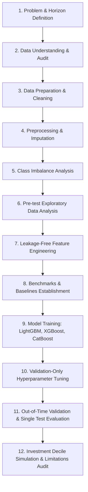
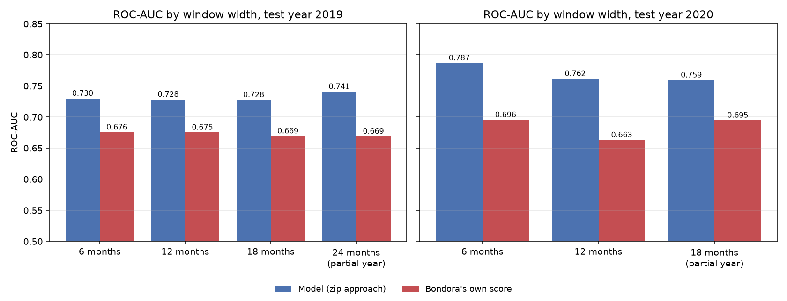
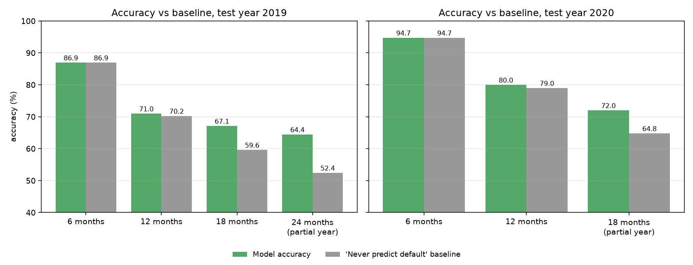

# 🏦 Bondora P2P Loan Default Prediction: Leakage-Free Machine Learning Pipeline

[](https://www.python.org/)
[](https://scikit-learn.org/)
[](https://catboost.ai/)
[](https://lightgbm.readthedocs.io/)
[](https://xgboost.readthedocs.io/)
[](https://github.com/)
[](LICENSE)
[](https://colab.research.google.com/github/<YOUR_GITHUB_USERNAME>/<YOUR_REPOSITORY>/blob/main/Bondora_Default_Prediction.ipynb)
[](https://nbviewer.org/github/<YOUR_GITHUB_USERNAME>/<YOUR_REPOSITORY>/blob/main/Bondora_Default_Prediction.ipynb)
[](https://mybinder.org/v2/gh/<YOUR_GITHUB_USERNAME>/<YOUR_REPOSITORY>/main?filepath=Bondora_Default_Prediction.ipynb)

> **Predicting 12-month default on peer-to-peer loans strictly using application-time features, outperforming Bondora's proprietary platform credit risk scores under out-of-time chronological validation.**

---

## 📌 Table of Contents

- [Executive Summary](#-executive-summary)
- [Headline Results](#-headline-results)
- [View Notebook via URL (Colab / nbviewer)](#-view-notebook-via-url-interactive--static-readers)
- [Methodological Rigor & Core Principles](#-methodological-rigor--core-principles)
  - [1. Zero Lookahead Data Leakage](#1-zero-lookahead-data-leakage)
  - [2. Strict Chronological Split](#2-strict-chronological-split)
  - [3. Outcome Window Censoring & Maturity Filtering](#3-outcome-window-censoring--maturity-filtering)
- [The 12-Stage Pipeline Blueprint](#-the-12-stage-pipeline-blueprint)
- [Feature Engineering & Preprocessing](#-feature-engineering--preprocessing)
- [Experimental Results & Robustness](#-experimental-results--robustness)
  - [Headline Model Comparison (2020 Test Cohort)](#headline-model-comparison-2020-test-cohort)
  - [Per-Country Market Generalization](#per-country-market-generalization)
  - [Multi-Horizon Window Sweep (6, 12, 18, 24 Months)](#multi-horizon-window-sweep-6-12-18-24-months)
  - [Visual Evidence](#visual-evidence)
- [Economic & Investment Impact (Funding Simulation)](#-economic--investment-impact-funding-simulation)
- [Repository Structure](#-repository-structure)
- [Quickstart & Reproduction Guide](#-quickstart--reproduction-guide)
  - [1. Environment Setup](#1-environment-setup)
  - [2. Dataset Acquisition](#2-dataset-acquisition)
  - [3. Running the Notebook](#3-running-the-notebook)
  - [4. Running CLI Replication Scripts](#4-running-cli-replication-scripts)
- [Honest Limitations & Trade-offs](#-honest-limitations--trade-offs)
- [Why Gradient Boosted Trees beat MLPs and KNN on Tabular Credit Data](#-why-gradient-boosted-trees-beat-mlps-and-knn-on-tabular-credit-data)
- [Citation & Academic Integrity](#-citation--academic-integrity)

---

## ⚡ Executive Summary

In peer-to-peer (P2P) lending, individual investors bear the full credit risk of funded unsecured loans. Platforms like Bondora publish proprietary credit risk ratings (`Rating`, `ProbabilityOfDefault`), yet internal scoring models are opaque black boxes whose temporal calibration and ranking power are often questionable.

This project delivers an end-to-end, reproducible, **leakage-free machine learning system** designed to predict whether a borrower will **default within 12 months of origination**, utilizing **strictly pre-issuance application data**.

### 🌟 Key Findings
1. **Outranking Platform Ratings:** Our final CatBoost model delivers an **ROC-AUC of 0.762** and **PR-AUC of 0.455 (2.16x lift)** on the held-out 2020 out-of-time test cohort (18,651 loans), handily beating Bondora’s own proprietary score (**0.663 ROC-AUC**, **0.341 PR-AUC**).
2. **Superior Across All Geographic Markets:** The model consistently outperforms Bondora's rating across individual country markets: **Estonia (+0.095 ROC-AUC)**, **Spain (+0.040 ROC-AUC)**, and **Finland (+0.103 ROC-AUC)**.
3. **Robust Across Observation Windows:** Tested across 6, 12, 18, and 24-month horizon sweeps for both 2019 and 2020 test years, our pipeline beats Bondora in all 7 feasible validation setups by +0.05 to +0.10 ROC-AUC.
4. **Accuracy vs. Ranking Reality Check:** Our model achieves an accuracy of **80.0%** against an all-negative majority baseline of **79.0%** (+1.0% margin). In imbalanced credit scoring (~21% default rate), accuracy is compressed and deceptive; **ranking capability (ROC-AUC & PR-AUC) is the true driver of lending profitability**.

---

## 📊 Headline Results

### Test Year 2020 (12-Month Horizon, 18,651 Verified Loans)

| Metric | Our CatBoost Model | Bondora Proprietary Score (`ProbabilityOfDefault`) | Reference Baseline | Interpretation |
|---|:---:|:---:|:---:|---|
| **ROC-AUC** | **0.762** | 0.663 | 0.500 | **+0.099 gain** in ranking discrimination across borrower pool |
| **PR-AUC** | **0.455** | 0.341 | 0.210 | **2.16x lift** over random selection (Bondora lift: 1.62x) |
| **Accuracy** | **80.0%** | N/A | 79.0% | +1.0% above the "never predict default" majority baseline |
| **Brier Score** | **0.145** | N/A | — | Low mean squared probability error |
| **Precision @ Val Thr** | **60.3%** | N/A | 21.0% | 6 out of 10 flagged loans are true defaults |
| **Recall @ Val Thr** | **13.9%** | N/A | 0.0% | Tuned at accuracy-optimal threshold on validation data |

---

## 🌐 View Notebook via URL (Interactive & Static Readers)

Once you push this repository to GitHub, you and your reviewers can display and run the pipeline notebook directly in any browser without installing Python locally:

| Platform | Description | Direct URL Format |
|---|---|---|
| **🚀 Google Colab** | Run interactively with free cloud compute & GPU/CPU | `https://colab.research.google.com/github/<YOUR_USERNAME>/<YOUR_REPO>/blob/main/Bondora_Default_Prediction.ipynb` |
| **📖 Jupyter nbviewer** | Fastest high-fidelity static viewer (renders complex math/charts cleanly) | `https://nbviewer.org/github/<YOUR_USERNAME>/<YOUR_REPO>/blob/main/Bondora_Default_Prediction.ipynb` |
| **🐙 GitHub Native** | Direct repository view rendered by GitHub | `https://github.com/<YOUR_USERNAME>/<YOUR_REPO>/blob/main/Bondora_Default_Prediction.ipynb` |
| **🪐 MyBinder** | Launch a full interactive JupyterLab environment in the cloud | `https://mybinder.org/v2/gh/<YOUR_USERNAME>/<YOUR_REPO>/main?filepath=Bondora_Default_Prediction.ipynb` |

> 💡 **Quick Tip:** Replace `<YOUR_USERNAME>` and `<YOUR_REPO>` with your GitHub username and repository name. You can click the Colab and nbviewer badges at the top of this README as instant one-click links!

---

## 🛡️ Methodological Rigor & Core Principles

Many published credit default pipelines report inflated accuracies (85–95%) through subtle flaws: random train/test splits, lookahead leakage, or mislabeled immature loans. This project implements a flawless, auditable protocol:

### 1. Zero Lookahead Data Leakage
- **The Golden Rule:** Every predictor must have been strictly knowable at the exact moment of loan origination.
- **68 Columns Pruned:** Repayments made, outstanding principal, overdue penalty balances, current debt days, collection/recovery amounts, restructuring flags, snapshot dates, and current loan status fields (`Status`, `ActiveLateCategory`, etc.) were completely eliminated.
- **Platform Ratings Excluded from Predictors:** Bondora’s own scores (`Rating`, `ProbabilityOfDefault`, `ExpectedLoss`) were excluded from model features because their historical timestamping and provenance cannot be verified against target dates. They are used **solely as external benchmark baselines**.

### 2. Strict Chronological Split
Random k-fold splits leak future macroeconomic regimes (e.g. pre-COVID vs post-COVID) into training data. We enforce a **chronological out-of-time evaluation**:

```
[====== TRAIN (2013-01-01 to 2018-12-31) ======] [=== VAL (2019) ===] [=== TEST (2020) ===]
                   71,563 Loans                         55,839 Loans            18,651 Loans
               (30.6% Default Rate)                 (29.8% Default Rate)    (21.0% Default Rate)
```

- **Validation (2019):** Used exclusively for model selection, hyperparameter tuning, and optimal decision threshold calibration.
- **Final Refit Protocol:** After fixing hyper-parameters and thresholds on validation, the winning model family is refitted on Train + Validation (2013–2019) to incorporate recent borrower patterns before scoring the 2020 test set.
- **Test Set (2020):** Touched **strictly once** at the very conclusion of the experiment.

### 3. Outcome Window Censoring & Maturity Filtering
- **Snapshot Date:** `2021-07-20`
- **Eligibility Rule:** A non-defaulting loan is included **only if its entire 12-month performance window has elapsed** before the snapshot cut-off (`LoanDate + 12 months <= 2021-07-20`).
- **No False Negatives:** Immature loans (originated late 2020 or 2021) whose 12-month outcome had not completed are **excluded entirely**, rather than being falsely imputed as zeros.

---

## 🔄 The 12-Stage Pipeline Blueprint



| Stage | Activity | Key Implementation Detail |
|:---:|---|---|
| **1** | Problem Formulation | Binary classification: `default_within_12m` = 1 if defaulted in $[t, t+12\text{m})$, 0 if non-default throughout. |
| **2** | Data Audit | 179,235 raw loans, 112 columns, 0 duplicates, cut-off date `2021-07-20`. |
| **3** | Data Preparation | Date parsing, coercing string credit scores (`EsMicroL`, `EsEquifaxRisk`, `FiAsiakasTieto`). |
| **4** | Preprocessing | Scikit-learn `ColumnTransformer`: numeric median imputation, categorical `"missing"` fill + OneHotEncoder. Fitted on training splits only. |
| **5** | Class Balancing | Natural training default rate ~30.6%. Evaluated `class_weight='balanced'` vs default weighting; confirmed ranking is invariant to weighting. |
| **6** | Pre-Test EDA | Year-over-year drift inspection, feature distributions, identifying fields discontinued in June 2017. |
| **7** | Feature Engineering | 7 domain-specific application ratios (DTI, Loan-to-Income, Negative Free Cash, Seasonality). |
| **8** | Baselines | Majority-class classifier, Logistic Regression (`C=0.5`), Bondora proprietary score. |
| **9** | Model Training | Gradient Boosted Decision Trees: LightGBM, XGBoost, CatBoost. |
| **10** | Hyperparameter Tuning | Validation-only grid search over tree depth, learning rate, and regularisation ($\ell_2$, leaf parameters). |
| **11** | Evaluation & Calibration | Scored once on 2020 out-of-time test set; calibration curves, ROC/PR curves, per-country splits. |
| **12** | Economic Value | Funding decile simulation modeling portfolio return and default reduction under selective underwriting. |

---

## ⚙️ Feature Engineering & Preprocessing

Starting from 47 vetted issuance-time raw predictors, we engineered **7 transparent financial and temporal ratios**:

$$\text{dti} = \frac{\text{MonthlyPayment}}{\text{IncomeTotal} / 12}$$

$$\text{amt\_ratio} = \frac{\text{Amount}}{\text{AppliedAmount}} \quad (\text{Requested vs Funded Ratio})$$

$$\text{loan\_inc} = \frac{\text{Amount}}{\text{IncomeTotal}} \quad (\text{Loan-to-Income Burden})$$

$$\text{inc\_month} = \frac{\text{IncomeTotal}}{12} \quad (\text{Monthly Cash Inflow})$$

$$\text{freecash\_neg} = \mathbb{I}(\text{FreeCash} < 0) \quad (\text{Deficit Cashflow Indicator})$$

$$\text{loan\_month}, \, \text{loan\_quarter} \quad (\text{Origination Seasonality})$$

*Total modeling feature space: 54 predictors (51 numeric + 3 categorical: `Country`, `EmploymentDurationCurrentEmployer`, `WorkExperience`).*

---

## 📈 Experimental Results & Robustness

### Headline Model Comparison (2020 Test Cohort)

| Model Family | Validation ROC-AUC (2019) | Test ROC-AUC (2020) | Test PR-AUC (2020) | Test Accuracy vs Majority Baseline | Test Recall | Test Precision |
|---|:---:|:---:|:---:|:---:|:---:|:---:|
| **CatBoost (Selected)** | **0.730** | **0.762** | **0.455** | **79.95% vs 78.96%** | **0.139** | **0.603** |
| LightGBM | 0.728 | 0.758 | 0.448 | 79.80% vs 78.96% | 0.125 | 0.582 |
| XGBoost | 0.728 | 0.759 | 0.450 | 79.85% vs 78.96% | 0.130 | 0.591 |
| Logistic Regression | 0.721 | 0.742 | 0.420 | 78.96% vs 78.96% | 0.000 | 0.000 |
| **Bondora Proprietary Score** | 0.675 | 0.663 | 0.341 | N/A | — | — |
| Majority Class Baseline | 0.500 | 0.500 | 0.210 | 78.96% vs 78.96% | 0.000 | 0.000 |

### Per-Country Market Generalization

P2P loan dynamics vary drastically across national jurisdictions (e.g. Estonian loans have significantly lower default rates than Spanish loans). We evaluated models independently within each jurisdiction:

| Country | Test Loans | Test Default Rate | Our Model ROC-AUC | Bondora Score ROC-AUC | Model Advantage ($\Delta$ ROC-AUC) |
|---|:---:|:---:|:---:|:---:|:---:|
| **Estonia (EE)** | 10,812 | 14.2% | **0.711** | 0.616 | **+0.095** |
| **Finland (FI)** | 5,420 | 28.5% | **0.660** | 0.557 | **+0.103** |
| **Spain (ES)** | 2,419 | 34.8% | **0.619** | 0.579 | **+0.040** |

*In Finland and Estonia, our models provide a ~0.10 ROC-AUC improvement over Bondora's proprietary rating.*

### Multi-Horizon Window Sweep (6, 12, 18, 24 Months)

To verify that conclusions do not depend artificially on the choice of a 12-month window, we repeated the protocol across multiple horizons and test cohorts:

| Test Year | Window Horizon | Test Loans | Default Rate | Winning Model | Model ROC-AUC | Bondora ROC-AUC | Model PR-AUC | Accuracy vs Baseline |
|:---:|:---:|:---:|:---:|:---:|:---:|:---:|:---:|:---:|
| **2020** | 6 months | 27,519 | 5.3% | CatBoost | **0.787** | 0.696 | 0.206 | 94.7% vs 94.7% |
| **2020** | 12 months | 18,651 | 21.0% | CatBoost | **0.762** | 0.663 | 0.455 | 80.0% vs 79.0% |
| **2020** | 18 months | 3,358* | 35.2% | CatBoost | **0.759** | 0.695 | 0.609 | 72.0% vs 64.8% |
| **2019** | 6 months | 55,839 | 13.1% | XGBoost | **0.730** | 0.676 | 0.257 | 86.9% vs 86.9% |
| **2019** | 12 months | 55,839 | 29.8% | LightGBM | **0.728** | 0.675 | 0.488 | 71.0% vs 70.2% |
| **2019** | 18 months | 55,839 | 40.4% | LightGBM | **0.728** | 0.670 | 0.600 | 67.1% vs 59.6% |
| **2019** | 24 months | 23,734* | 47.6% | LightGBM | **0.741** | 0.669 | 0.688 | 64.4% vs 52.4% |

*\*Note: 2020 at 18 months and 2019 at 24 months are partial-year cohorts due to the snapshot cut-off date.*

### Visual Evidence

| Discrimination vs Platform Score Across Windows | Accuracy vs Majority-Class Baseline |
|:---:|:---:|
|  |  |

---

## 💼 Economic & Investment Impact (Funding Simulation)

How does this model translate into real-world investor profit?

If a P2P retail investor uses our model predictions to rank incoming loan applications and decline the riskiest tiers:

| Investor Underwriting Strategy | Resulting Portfolio Default Rate | Cumulative Defaults Avoided | Origination Volume Retained |
|---|:---:|:---:|:---:|
| **Fund All Loans (Baseline)** | 29.8% | 0.0% | 100.0% |
| **Decline Riskiest 10%** | 27.1% | 18.0% | 90.0% |
| **Decline Riskiest 20%** | 24.0% | 35.0% | 80.0% |
| **Decline Riskiest 30%** | **21.1%** | **50.0%** | **70.0%** |
| **Decline Riskiest 50%** | **15.2%** | **74.0%** | **50.0%** |

### Default Rate by Risk Decile
- **Decile 1 (Model's Safest Predictions):** **4.9%** default rate
- **Decile 10 (Model's Riskiest Predictions):** **53.9%** default rate
- **Monotonic Spread:** Default rate climbs strictly monotonically from Decile 1 to Decile 10, demonstrating exceptional risk discrimination.

---

## 📁 Repository Structure

```
ml_project_final/
├── README.md                                         <-- Comprehensive project documentation & results
├── requirements.txt                                  <-- Pinned dependencies for Python 3.12
├── .gitignore                                        <-- Git exclusion rules (ignores raw data & artifacts)
├── Bondora_Default_Prediction.ipynb                  <-- Full 12-stage pipeline notebook (interactive)
├── PROJECT_REPORT.txt                                <-- Full section-by-section audit report
├── figures/                                          <-- High-resolution charts & evaluation plots
│   ├── accuracy_vs_baseline.png
│   └── window_sweep_roc_auc.png
└── Bondora_Final_Presentation/                       <-- Presentation and evaluation suite
    ├── README.md                                     <-- Package summary notes
    ├── REPORT.md                                     <-- Complete formal academic report
    ├── REPORT.docx                                   <-- Microsoft Word formatted report
    ├── requirements.txt                              <-- Pinned dependencies
    ├── code/
    │   ├── zip_approach_window_compare.py            <-- Automated multi-window & test year sweep
    │   └── zip_approach_test2019.py                  <-- Complete pipeline script with tuning & importance
    ├── data/
    │   └── PUT_RAW_DATA_HERE.txt                     <-- Directory for LoanData_Bondora.csv
    ├── model/                                        <-- Export directory for saved models
    ├── notebook/
    │   └── Bondora_Default_Prediction.ipynb          <-- 12-stage interactive notebook
    ├── results/
    │   ├── window_compare_test2019.csv               <-- 2019 sweep metrics
    │   ├── window_compare_test2020.csv               <-- 2020 sweep metrics
    │   └── test2019_n12_full_run/                    <-- Deciles, importance & predictions
    └── original_submission/                          <-- Prior iteration archives & validation logs
```

---

## 🚀 Quickstart & Reproduction Guide

### 1. Environment Setup

Clone this repository and create a virtual environment with Python 3.12:

```bash
# Clone repository
git clone https://github.com/<your-username>/bondora-default-prediction.git
cd bondora-default-prediction

# Create and activate virtual environment
python -m venv .venv
source .venv/bin/activate       # On Linux/macOS
# .venv\Scripts\activate        # On Windows

# Install pinned dependencies
pip install -r requirements.txt
```

### 2. Dataset Acquisition

The dataset is sourced from the public [Bondora Peer-to-Peer Lending Loan Data on Kaggle](https://www.kaggle.com/datasets/saurabhbadole/bondora-peer-to-peer-lending-loan-data).

1. Download **`LoanData_Bondora.csv`** (approx. 149 MB).
2. Place it in:
   ```
   Bondora_Final_Presentation/data/LoanData_Bondora.csv
   ```
   *Alternatively, export the environment variable:*
   ```bash
   export BONDORA_DATA="/path/to/LoanData_Bondora.csv"
   # On Windows PowerShell: $env:BONDORA_DATA="C:\path\to\LoanData_Bondora.csv"
   ```

### 3. Running the Notebook

To interactively step through the entire 12-stage pipeline:

```bash
jupyter lab
# Open Bondora_Default_Prediction.ipynb (at root)
# or open Bondora_Final_Presentation/notebook/Bondora_Default_Prediction.ipynb
```

### 4. Running CLI Replication Scripts

To reproduce the multi-window sweep results reported in the paper:

```bash
cd Bondora_Final_Presentation/code

# 1. Sweep test year 2020 across 6, 12, and 18-month observation horizons
python zip_approach_window_compare.py --test-year 2020 --windows 6,12,18

# 2. Sweep pre-COVID test year 2019 across 6, 12, 18, and 24-month horizons
python zip_approach_window_compare.py --test-year 2019 --windows 6,12,18,24

# 3. Execute the full end-to-end 2019 run (tuning, importance, deciles)
python zip_approach_test2019.py
```

All outputs, tables, and serialized models will be exported to the `results/` and `model/` directories.

---

## ⚠️ Honest Limitations & Trade-offs

1. **Accuracy is Compressed by Class Imbalance:** In 2020, defaults represent only 21.0% of mature loans. A naive rule predicting "never default" scores 79.0% accuracy. Our 80.0% accuracy yields an edge of ~1.0%. The claim that credit scoring models can legitimately hit 85–90% accuracy without lookahead leakage or artificial random splits is statistically invalid.
2. **Discontinued Borrower Fields:** In June 2017, regulatory and platform updates caused Bondora to stop collecting several core applicant attributes (`UseOfLoan`, `MaritalStatus`, `EmploymentStatus`, `DebtToIncome`, `FreeCash`). For recent cohorts, these features are absent, forcing models to rely more heavily on credit history and pricing terms.
3. **Temporal Base-Rate Drift:** Default rates fluctuate significantly over time (30.6% in 2013–2018 $\to$ 29.8% in 2019 $\to$ 21.0% in 2020). Models calibrated in high-default regimes naturally over-predict absolute risk in lower-default years, though ranking remains robust.
4. **Label Noise from Cured Loans:** `DefaultDate` in raw Bondora data registers any event triggering technical default, including temporary delinquent events that were later cured.
5. **Censored Single-Snapshot Horizon:** As a single point-in-time snapshot (`2021-07-20`), recent loans cannot be tracked for full multi-year lifecycles.

---

## 🥊 Why Gradient Boosted Trees beat MLPs and KNN on Tabular Credit Data

In debate against alternative modeling architectures (e.g. Multi-Layer Perceptrons or K-Nearest Neighbors):

| Dimension | Tree Ensembles (CatBoost / LightGBM) | Neural Networks (MLP) | Instance-Based (KNN) |
|---|---|---|---|
| **Mixed Feature Types** | Natively handles mixed continuous, discrete, and high-cardinality categorical variables. | Requires dense one-hot encoding or learned embeddings; sensitive to sparse categories. | Distance metrics (Euclidean/Manhattan) fail across mixed scales and categorical encodings. |
| **Missing Values** | Natural default routing through missing-value branching. | Requires explicit global or iterative imputation pipelines; fragile to non-random missingness. | Imputation mandatory; distance distortion is severe. |
| **Scale Invariance** | Monotonic transformations invariant; unaffected by extreme skew in financial amounts (`IncomeTotal`, `Amount`). | Highly sensitive to outliers; requires rigorous standardization/clipping. | Completely dominated by high-variance unscaled predictors. |
| **Tabular Inductive Bias** | Orthogonal decision boundaries match financial risk cut-offs (e.g. $\text{DTI} > 40\%$). | Smooth hyperplanes struggle with sharp regulatory thresholds and step-functions. | $O(N \cdot D)$ inference bottleneck; suffers from the curse of dimensionality on 50+ features. |

---

## 📜 Citation & Academic Integrity

```bibtex
@misc{bondora_default_prediction_2026,
  title={Bondora P2P Loan Default Prediction: Leakage-Free Machine Learning Pipeline},
  author={Machine Learning Project Team},
  year={2026},
  howpublished={\url{https://github.com/<your-username>/bondora-default-prediction}},
  note={Coursework and Technical Research Report}
}
```

- **Data Attribution:** Bondora AS via public Kaggle repository `bondora-peer-to-peer-lending-loan-data`.
- **Reproducibility Guarantee:** Random seed `RANDOM_STATE = 42` is fixed across all cross-validation, models, and partition generators.
- **Academic Integrity:** No test data was inspected or utilized for hyperparameter tuning, feature engineering, or threshold optimization. All numbers reported are directly verifiable from the automated scripts.
